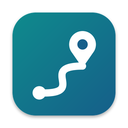

<p align="center"></p>

# Business Miles

Fahrten zum Kunden erfassen – mit automatischer Kilometerberechnung, Monats- und Jahressummen
und einem steuertauglichen Export. Eine App für **Mac** und **iPhone**, abgeglichen über **iCloud**,
inklusive **Widget**.

---

## Funktionen

| Bereich | Umsetzung |
|---|---|
| **Start-Popup** | Helles Popup mit Logo und Schriftzug beim App-Start (≈ 1,6 s, blendet weich aus) |
| **Neue Fahrt** | Datum · Kunde/Geschäftspartner · Anlass · Zieladresse · Start · Rückfahrt · Notiz |
| **Adresshilfe** | PLZ eingeben → Ort wird automatisch ergänzt. Beim Tippen der Straße erscheinen Vorschläge (Apple Maps) |
| **Startadresse** | In den Einstellungen fest hinterlegt und bei jeder Fahrt vorausgewählt; per Klick „Andere Adresse“ |
| **Hin & zurück** | Standardmäßig Hin- und Rückfahrt; Rückfahrt abschaltbar oder zu einer anderen Adresse |
| **Kilometer** | Automatisch per Apple Maps (Auto, empfohlene Route), getrennt für Hin- und Rückfahrt, jederzeit überschreibbar |
| **Übersicht** | Kennzahlen (km, Fahrten, Ø, Pauschale), Monatsdiagramm, Fahrten nach Monaten mit Monatssummen |
| **Jahres-Kacheln** | Mac: senkrechter Slider rechts · iPhone: waagerechter Slider oben |
| **Export** | Excel (.xlsx, mit Formeln) · PDF (A4 quer, mit Unterschriftsfeld) · iPhone: Bild in Fotos |
| **Zeitraum** | Ganzes Jahr oder einzelner Monat |
| **Zielordner (Mac)** | Fester Exportordner in den Einstellungen, sonst Sichern-Dialog |
| **Steuerangaben** | Name, Firma, Steuernummer, Anschrift, Fahrzeug, Kennzeichen, km-Satz (Pkw 0,30 € / Motorrad 0,20 € / eigener) |
| **Widget** | Klein: km im Monat + Jahr · Mittel: zusätzlich letzte Fahrt und Button „Neue Fahrt“ |
| **Sync** | iCloud (CloudKit, private Datenbank) – Fahrten und Einstellungen erscheinen auf allen Geräten |
| **Extras** | „Letzte Ziele“ als Schnellauswahl · Fahrt duplizieren · ⌘N für neue Fahrt (Mac) |

---

## Voraussetzungen

- Mac mit **Xcode 16** oder neuer
- **macOS 14** (Sonoma) bzw. **iOS 17** oder neuer auf den Geräten
- **Apple Developer Program** (99 €/Jahr) – nötig für **iCloud-Sync** und das gemeinsame Daten-Fach für das **Widget** (App Group).
  Mit einem kostenlosen Apple-Account läuft die App nur lokal ohne Sync (siehe unten).
- [XcodeGen](https://github.com/yonaskolb/XcodeGen) zum Erzeugen des Xcode-Projekts

## Einrichtung (einmalig, ca. 10 Minuten)

```bash
# 1. XcodeGen installieren (Homebrew)
brew install xcodegen

# 2. Repository holen
git clone <repo-url> Business-Miles && cd Business-Miles
```

3. In **`project.yml`** ganz oben zwei Werte eintragen:
   ```yaml
   BUNDLE_ID_PREFIX: de.deinefirma      # eigene umgekehrte Domain
   DEVELOPMENT_TEAM: ABCDE12345         # Team-ID: developer.apple.com → Account → Membership
   ```
4. Projekt erzeugen und öffnen:
   ```bash
   xcodegen generate
   open BusinessMiles.xcodeproj
   ```
5. In Xcode einmal je App-Target (**BusinessMiles-iOS**, **BusinessMiles-macOS**) unter
   *Signing & Capabilities* prüfen, dass das Team gesetzt ist. Xcode legt iCloud-Container
   (`iCloud.<prefix>.businessmiles`) und App Group automatisch an.
6. Schema **BusinessMiles-macOS** → *Run* (⌘R) startet die Mac-App.
   Schema **BusinessMiles-iOS** mit angeschlossenem iPhone → *Run* installiert die Handy-App.
7. Widget hinzufügen: Mac → Mitteilungszentrale → „Widgets bearbeiten“ · iPhone → Home-Bildschirm lange drücken → „+“.

> **Sync testen:** Auf beiden Geräten mit derselben Apple-ID in iCloud angemeldet sein.
> Neue Fahrten erscheinen nach wenigen Sekunden bis Minuten auf dem anderen Gerät.
> In den Einstellungen der App zeigt „Synchronisation“, ob iCloud aktiv ist.

### Ohne bezahlten Developer-Account

In `project.yml` bei beiden App-Targets die Einträge unter `entitlements → properties` für
`icloud-*`, `aps-environment` und `application-groups` entfernen. Die App speichert dann nur lokal,
und das Widget zeigt keine Daten. Hinweis: Mit kostenlosem Account installierte iPhone-Apps
laufen nur 7 Tage und müssen dann neu aus Xcode installiert werden.

### Vor einer Veröffentlichung (TestFlight / App Store)

Im [CloudKit Dashboard](https://icloud.developer.apple.com) das Schema von *Development* nach
*Production* übernehmen („Deploy Schema Changes“), sonst synchronisieren veröffentlichte Builds nicht.

---

## Hinweise zur Steuer

- Der Export enthält je Fahrt: **Datum, Kunde/Geschäftspartner, Anlass, Start-, Ziel- und Rückfahrtadresse,
  Hin-/Rück-/Gesamt-km und Betrag**, dazu Monats- und Gesamtsummen sowie Name, Anschrift,
  Steuernummer, Fahrzeug, Kennzeichen und den angesetzten km-Satz.
- Voreingestellt sind die Pauschalen für betrieblich veranlasste Fahrten mit privatem Fahrzeug:
  **0,30 €/km (Pkw)** bzw. **0,20 €/km (Motorrad/Motorroller)**. Der Satz ist änderbar.
- Die Startadresse wird beim Speichern **in jede Fahrt kopiert** – ein späterer Umzug verändert alte Einträge nicht.
- Die App ersetzt **kein ordnungsgemäßes Fahrtenbuch** (z. B. zur Widerlegung der 1-%-Regelung beim
  Firmenwagen; dafür wären u. a. Kilometerstände und Unveränderbarkeit nötig). Im Zweifel mit der
  Steuerberatung abstimmen.
- Die km stammen aus der Routenberechnung von Apple Maps (empfohlene Route) und können abweichen –
  bei Umwegen bitte manuell anpassen.

---

## Aufbau

```
project.yml                  XcodeGen-Projekt (4 Targets: App + Widget für iOS und macOS)
Sources/Core/                Gemeinsam für App und Widget: Farben, Logo, Formatierung, Widget-Daten
Sources/App/
  BusinessMilesApp.swift     Einstieg, Start-Popup, Menübefehle
  Models/                    Trip, UserProfile (SwiftData, CloudKit-kompatibel), AddressValue
  Persistence/               Container (iCloud → lokal → Speicher), Widget-Aktualisierung
  Services/                  Adressvorschläge, PLZ→Ort, Routen-km (MapKit)
  Logic/                     Gruppierung nach Jahr/Monat
  Views/                     Hauptansicht, Jahres-Kacheln, Editor, Einstellungen, Export
  Export/                    XLSX-Writer (inkl. ZIP), PDF-/Bildseiten, Speichern/Teilen
Sources/Widget/              WidgetKit-Erweiterung (klein/mittel)
Resources/Assets.xcassets    App-Icon, Akzentfarbe
tools/make_icons.py          Erzeugt die App-Icons neu (python3 tools/make_icons.py)
```

**Technik:** SwiftUI · SwiftData + CloudKit · MapKit · WidgetKit · Swift Charts — keine Fremdbibliotheken,
keine Server, keine API-Schlüssel.
