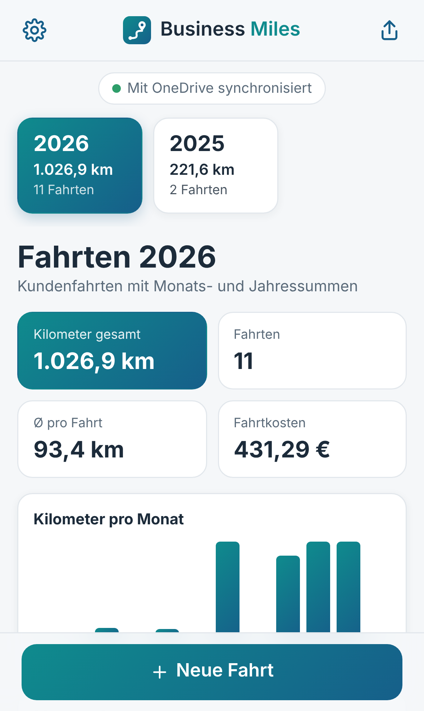
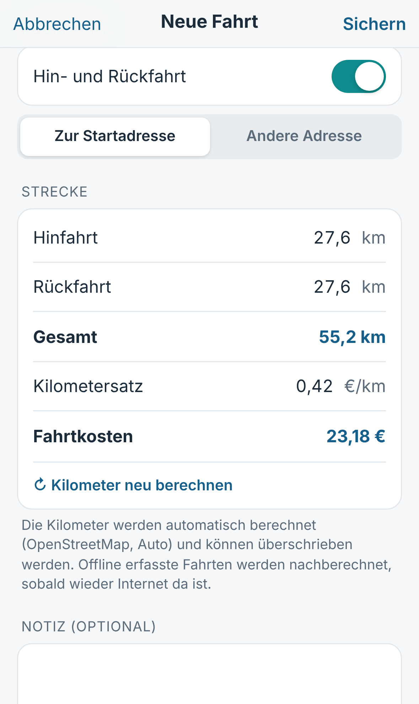
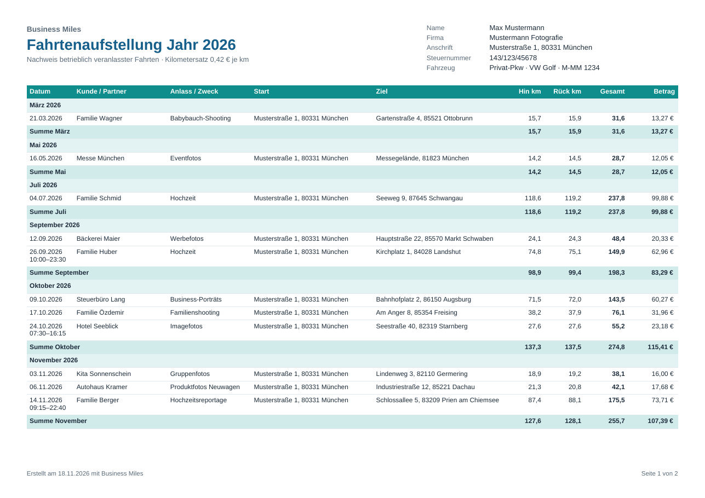

<p align="center"></p>

# Business Miles

Fahrten zum Kunden erfassen – mit automatischer Kilometerberechnung, Monats- und Jahressummen
und einem steuertauglichen Export.

- **Mac:** native App mit Widget
- **iPhone:** Web-App auf dem Home-Bildschirm (funktioniert auch offline)
- **Daten:** eine Datei in deinem **OneDrive-Ordner `Business-Miles`** – Mac und iPhone lesen und schreiben dieselbe Datei
- **Kosten:** 0 € – kein Apple-Developer-Account, kein Server, keine API-Schlüssel

```
   Mac-App ──(OneDrive-Client)──┐
                                ├──►  OneDrive › Business-Miles › business-miles.json
   iPhone-Web-App ──(Microsoft Graph)──┘
```

## So sieht es aus

| iPhone – Übersicht | iPhone – Neue Fahrt | Export (PDF) |
|---|---|---|
|  |  |  |

Mac-App und Widget: siehe [`docs/screenshots`](docs/screenshots) (werden automatisch auf einem Mac erzeugt).

---

## Funktionen

| Bereich | Mac | iPhone |
|---|---|---|
| Start-Popup mit Logo | ✓ | ✓ |
| Neue Fahrt: Datum, Kunde, Anlass, Ziel, Start, Rückfahrt, Notiz | ✓ | ✓ |
| PLZ → Ort automatisch (offline, mit Auswahl bei mehreren Orten) | ✓ | ✓ |
| Straßenvorschläge beim Tippen | Apple Karten | OpenStreetMap (Photon) |
| km automatisch, Hin- und Rückfahrt getrennt, überschreibbar | Apple Karten | OpenStreetMap (OSRM) |
| Startadresse vorausgewählt, „Andere Adresse“ per Klick | ✓ | ✓ |
| Jahres-Kacheln | senkrecht rechts | waagerecht oben |
| Monats- und Jahressummen, Diagramm, Pauschale | ✓ | ✓ |
| Export Excel (.xlsx) und PDF | in Zielordner | Teilen / In Dateien sichern |
| Kilometersatz frei einstellbar, je Fahrt gespeichert | ✓ | ✓ |
| Optionale Uhrzeiten (Abfahrt/Rückkehr) | ✓ | ✓ |
| Export als Bild für die Galerie | – | ✓ (in Fotos sichern) |
| Widget | ✓ (klein + mittel) | – |
| Offline erfassen, später automatisch abgleichen | ✓ | ✓ (Zwischenspeicher) |

**Abgleich:** Es wird nie die ganze Datei überschrieben. Jede Fahrt wird einzeln zusammengeführt
(die jüngere Änderung gewinnt), Löschungen werden übertragen. Offline erfasste Fahrten
ohne Kilometer werden nachberechnet, sobald ein Gerät wieder online ist („km folgen“).
Details: [`docs/DATENFORMAT.md`](docs/DATENFORMAT.md).

---

## Einrichtung

👉 **Schritt-für-Schritt-Anleitung: [`docs/ANLEITUNG.md`](docs/ANLEITUNG.md)**

Kurzfassung:

1. Repository öffentlich machen, *Settings → Pages → Source: GitHub Actions*, Workflow „Web-App veröffentlichen“ starten.
2. In [entra.microsoft.com](https://entra.microsoft.com) eine App-Registrierung „Business Miles“ anlegen
   (SPA, Umleitung `https://ziege1988.github.io/Business-Miles-/`, Berechtigung `Files.ReadWrite`)
   und Client-ID + Mandanten-ID in [`web/js/config.js`](web/js/config.js) eintragen.
3. Mac-App unter **Releases** als ZIP laden, in *Programme* ziehen, einmalig in
   *Systemeinstellungen → Datenschutz & Sicherheit* „Dennoch öffnen“.
4. iPhone: Safari → Web-App öffnen → *Teilen → Zum Home-Bildschirm* → Anmelden.

**Kein Apple-Developer-Account, keine Team-ID:** Die Mac-App wird von GitHub automatisch auf einem
Mac gebaut (Workflow `.github/workflows/mac-app.yml`) und „ad hoc“ signiert. Selbst bauen ist
optional: `brew install xcodegen && xcodegen generate && open BusinessMiles.xcodeproj` → ⌘R.

---

## Hinweise zur Steuer

- Der Export enthält je Fahrt: **Datum, Abfahrt, Rückkehr, Kunde/Geschäftspartner, Anlass,
  Start-, Ziel- und Rückfahrtadresse, Hin-/Rück-/Gesamt-km, €/km, Betrag und Bemerkung**, dazu
  Monats- und Gesamtsummen, Name, Firma, Anschrift, Steuernummer, Fahrzeug (Privatfahrzeug,
  Bezeichnung, Kennzeichen), Art der Fahrten, Zeitraum sowie Felder für Ort, Datum und Unterschrift.
- Der **Kilometersatz ist frei einstellbar** (Einstellungen) und wird **je Fahrt gespeichert** –
  ändert sich der Satz, behalten frühere Fahrten ihren Satz; einzelne Fahrten können abweichen.
  Schnellwahl: 0,30 €/km (Pkw) bzw. 0,20 €/km (Motorrad/Motorroller).
- Optional je Fahrt: **Abfahrts- und Rückkehrzeit** (z. B. für den Verpflegungsmehraufwand bei mehr
  als 8 Stunden Abwesenheit) und eine **Bemerkung** (z. B. Umweg und Grund).
- Die Startadresse wird beim Speichern **in jede Fahrt kopiert** – ein späterer Umzug verändert alte Einträge nicht.
- Kilometer stammen aus der Routenberechnung (Mac: Apple Karten, iPhone: OpenStreetMap) und können
  sich zwischen den Geräten leicht unterscheiden. Bei Umwegen bitte manuell anpassen.
- Im Zweifel mit der Steuerberatung abstimmen.

---

## Aufbau

```
project.yml                 XcodeGen-Projekt: Mac-App + Widget
Sources/Core/               Gemeinsam für App und Widget: Farben, Logo, Formatierung, Widget-Daten
Sources/App/
  Models/                   Trip, AppSettings, DataFile (Dateiformat + Zusammenführung)
  Persistence/TripStore     OneDrive-Datei lesen/zusammenführen/schreiben, Offline-Kopie, Konfliktkopien
  Services/                 Adressvorschläge, Routen-km (MapKit), PLZ-Tabelle
  Views/                    Hauptansicht, Jahres-Kacheln, Editor, Einstellungen, Export
  Export/                   XLSX-Writer (inkl. ZIP), PDF-Seiten
Sources/Widget/             WidgetKit-Erweiterung
Resources/plz.json          PLZ → Ort (8.168 Postleitzahlen)
web/                        iPhone-Web-App (ohne Build-Schritt)
  js/model.js               Dateiformat + Zusammenführung (identisch zur Mac-App)
  js/store.js               Zwischenspeicher + Abgleich mit OneDrive
  js/graph.js               Microsoft-Anmeldung + OneDrive-Zugriff
  js/geo.js                 PLZ, Straßenvorschläge, Routen
  js/exports.js             Excel, PDF, Bilder
  sw.js                     Offline-Betrieb
tests/                      Tests (node --test tests/model.test.mjs)
tools/                      Icons und PLZ-Tabelle neu erzeugen
```

**Drittanbieter:** MSAL.js v3 (MIT; v3 statt v4, weil v4 die Anmeldung beim Schließen der App verwirft), jsPDF + AutoTable (MIT) liegen unter `web/vendor/`.
PLZ-Daten © OpenStreetMap-Mitwirkende (ODbL), aufbereitet von suche-postleitzahl.org.
Adressen/Routen auf dem iPhone: Photon (komoot), Nominatim, OSRM/FOSSGIS – kostenlose
OpenStreetMap-Dienste für moderate private Nutzung.
